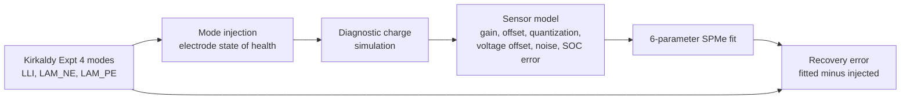

# Field-DMA: Degradation-Mode Diagnosis from Field BMS Charge Data

PyBaMM-based recovery of loss of lithium inventory (LLI) and loss of active material in the negative and positive electrodes (LAM_NE, LAM_PE) from field-representative battery management system (BMS) charge data, and the sensing, charging-protocol and fitting conditions under which recovery holds.

This work demonstrates an approach under controlled conditions built on the Kirkaldy dataset; the numbers show relative effects and design trade-offs.

Stages marked "In progress" are under way.

## Contents
- [0. Problem statement](#0-problem-statement)
- [1. Requirements](#1-requirements)
- [2. Scope and approach](#2-scope-and-approach)
- [3. Fit-model choice](#3-fit-model-choice)
- [4. Ground truth and mode injection](#4-ground-truth-and-mode-injection)
- [5. Field-logged data](#5-field-logged-data)
- [6. Inverse problem](#6-inverse-problem)
- [7. Identifiability ladder and levers](#7-identifiability-ladder-and-levers)
- [8. Robustness](#8-robustness)
- [9. Validation across eight cells](#9-validation-across-eight-cells)
- [10. Current-sensor offset and pack groups](#10-current-sensor-offset-and-pack-groups)
- [11. Equivalent circuit models](#11-equivalent-circuit-models)
- [12. Group-level diagnosis](#12-group-level-diagnosis)
- [13. Knee early warning](#13-knee-early-warning)
- [14. Conclusions and recommendations](#14-conclusions-and-recommendations)
- [15. Assumptions, limitations and reproducibility](#15-assumptions-limitations-and-reproducibility)
- [References](#references)

## 0. Problem statement

Capacity fade in lithium-ion cells results from several degradation modes. This work considers three: loss of lithium inventory (LLI), loss of active material in the negative electrode (LAM_NE) and loss of active material in the positive electrode (LAM_PE) [1], [2]. Cells at the same state of health (SoH) can carry different combinations of these modes. The combination sets the negative-electrode capacity margin at full charge, which is linked to the onset of the ageing knee [3].

Mode estimates are normally obtained from reference performance tests (RPTs). In the dataset used here, every RPT is run at 25 °C and includes a full C/10 discharge-charge cycle between 2.5 V and 4.2 V, which alone takes about 20 h [4]. The C/10 curve is treated as a pseudo-open-circuit-voltage (OCV) curve, and the modes are obtained by fitting half-cell potential curves for graphite, silicon and NMC811 to it [4]. Vehicle BMS logs contain no such test. They record partial charges that start at arbitrary state of charge (SOC), run at rates set by the charger, and carry current and voltage sensor errors.

This work determines whether LLI, LAM_NE and LAM_PE can be recovered from field-representative BMS charge data. It also identifies the sensor, charging-protocol and fitting conditions under which recovery holds. The problem is treated as one of observability before inference: the logged data must contain enough signal to separate the three modes before the fitting method matters. Data-driven SoH estimation is not used, because it does not resolve individual modes. Stages 6 and 7 report the results.

## 1. Requirements

The requirements are stated before any results. The target requirement follows from the intended use and does not depend on this work's results. The derived requirements are conditions on logging hardware and charging protocol that the analysis shows are needed to meet the target. Each derived requirement is traced to the stage where it is established. Stage 14 reports the verification status of all requirements.

The intended use is early warning of the ageing knee. The predictor is negative-electrode headroom at full charge, calculated from LLI, LAM_NE and LAM_PE [3], [5]. The required mode accuracy is the largest mode error that keeps the headroom estimate within the warning margin.

*Table 1. Requirements.*

| ID | Requirement | Type | Established in |
|---|---|---|---|
| RQ1 | Mode recovery accurate enough for knee warning | Target | Stage 13 |
| RQ2 | Contactor state logged, so rests are identified and logged current is set to zero | Derived | Stage 10 |
| RQ3 | Charge throughput from an Ah counter, or current logged at 0.01 A resolution or finer | Derived | Stage 10 |
| RQ4 | Current-sensor offset zeroed during contactor-open rests | Derived | Stage 10 |
| RQ5 | Diagnostic charge entered at 30% SOC or below, constant-current constant-voltage (CC-CV) to 4.2 V, with logged 60 min rests before and after | Derived | Stage 7 |

In progress: RQ1 threshold value from the knee study.

## 2. Scope and approach

All analysis is built on Experiment 4 of the Kirkaldy dataset, which is treated as the reference throughout [4], [6]. Experiment 4 aged eight LG M50T 21700 cells (NMC811 positive electrode, graphite-SiOx negative electrode) at base-cooled set-points of 10, 25 and 40 °C. Each ageing set consisted of 78 cycles. Each cycle was a 0.3C CC-CV charge to 4.2 V, to a C/100 cut-off, followed by a discharge to 2.5 V on a drive cycle based on the Worldwide harmonised Light vehicle Test Procedure (WLTP). The dataset reports LLI, LAM_NE and LAM_PE for each cell at each RPT.

The study is semi-synthetic (Figure 1). Modes reported in the dataset are injected into a PyBaMM model of the LG M50T [7], parameterised with the O'Regan 2022 set [8]. The model generates the charge segment a vehicle BMS would log. A sensor model then adds current gain, current offset, current quantization, voltage offset and voltage noise, and perturbs the starting SOC. The fitter estimates the modes from this logged segment. Recovery error is the difference between fitted and injected modes. This design was chosen because no field logs with known modes are available, and because it isolates the effect of each sensor, protocol and fitting choice.

*Figure 1. Semi-synthetic recovery pipeline.*

Modes are imposed directly, following the prescribed-mode approach [1], rather than generated by coupled ageing-mechanism models [9]. The single particle model with electrolyte (SPMe) is the fitting model [10]. The Doyle-Fuller-Newman (DFN) model serves as a higher-fidelity reference for model-form error. The model treats the negative electrode as a single graphite material, so the dataset's LAM_NE is used as the capacity-weighted total of the graphite and SiOx losses. The fit residual is cell voltage against charge throughput, V(Q), rather than its derivative dQ/dV, because differentiation amplifies measurement noise [2].

Three levers are evaluated (Table 2). Out of scope: uncertainty quantification, mechanism-generated ground truth, pack-level state estimation and extrapolation to 96-series packs.

*Table 2. Levers evaluated.*

| Lever | Covers | Set by |
|---|---|---|
| BMS sensing | Sensor grade, current resolution or Ah counter, offset zeroing at rest, contactor-state logging | BMS design |
| Charging protocol | Entry SOC of 30% or below, CC-CV to 4.2 V, rests before and after the charge | Driver and charger |
| Fitting algorithm | 6-parameter fit, rest clamp using contactor state | Offboard analysis |

## 3. Fit-model choice

The fitting model must meet three conditions. It has to reproduce the logged voltage closely enough that its own error does not bias the fitted modes. It has to represent the physical quantities the modes act on. It also has to be fast enough to run inside an iterative fit: one 6-parameter fit in this work takes about 200 to 250 simulations of the diagnostic charge (Stage 6). Three physics-based PyBaMM models were compared [7]:

- **DFN:** resolves lithium concentration and potential in the electrolyte, and in particles at each position through the electrode thickness.
- **SPMe:** represents each electrode by a single particle and adds a correction for electrolyte concentration and potential, derived as an asymptotic reduction of the DFN [10].
- **Single particle model (SPM):** keeps particle diffusion and reaction kinetics but omits the electrolyte.

All three models were run on a beginning-of-life cell, under isothermal conditions at 10, 25 and 40 °C, with the O'Regan 2022 parameters [8]. The protocol replicates Kirkaldy Experiment 4 [4]: a 1 h rest at 100% SOC, a 250 mAh discharge at 1C, then the WLTP profile repeated until the voltage reaches 2.5 V (6.48 h). Table 3 lists the root-mean-square (RMS) voltage error against the DFN, the number of states, and the solve time at 25 °C.

*Table 3. WLTP voltage error against the DFN, isothermal, beginning of life. Solve times are for the IDAKLU solver on a single workstation ([data](results/model_hierarchy.csv)).*

| Model | States | RMS error, 10 °C (mV) | RMS error, 25 °C (mV) | RMS error, 40 °C (mV) | Solve time, 25 °C (s) |
|---|---|---|---|---|---|
| DFN | 962 | reference | reference | reference | 156 |
| SPMe | 102 | 6.70 | 3.20 | 1.72 | 25.5 |
| SPM | 42 | 31.5 | 18.6 | 12.3 | 4.6 |

The SPMe error is 4.7 to 7.2 times smaller than the SPM error. The SPMe solves 6.1 times faster than the DFN, and the SPM 34 times faster. Both errors rise as temperature falls, consistent with larger electrolyte and solid-diffusion overpotentials at low temperature.

Three further properties support the SPMe.

1. **Mode-to-parameter mapping.** All three physics models share the same electrode parameters: active-material volume fraction, maximum lithium concentration and electrode capacity. Each degradation mode therefore maps directly onto a model parameter (Stage 4). An equivalent circuit model has no such parameters.
2. **Electrolyte physics.** The SPMe captures the electrolyte overpotential during the constant-current charge, and its relaxation during the rests that follow. The fit uses both segments (Stage 6). The SPM omits this contribution, so the fitter would have to absorb it into the modes, the entry SOC or the series resistance.
3. **Validity at the fit conditions.** The SPMe reduction holds when electrolyte diffusion is fast relative to the timescale set by the applied current [10]. The diagnostic charge runs at 0.15C, well below the peak currents of the WLTP profile.

The DFN contains the same physics as the SPMe, plus variation through the electrode thickness. At 0.15C this added resolution changes the terminal voltage of cell E at RPT 7 by 2.7 mV RMS during the constant-current charge and by 5.1 mV during the post-charge rest. The difference is of similar size at beginning of life, and changes by less than 6% when the mesh is refined, so it is a structural property of the SPMe rather than a discretisation or ageing effect (Stage 8). The SPMe is therefore used as the fitting model, and the DFN as the reference for model-form checks.

The SPMe does not resolve processes that vary through the electrode thickness, such as lithium plating near the separator at low temperature. This does not affect the present study, because the modes are prescribed rather than generated by mechanisms. It does limit use of the SPMe for mechanism-generated truth, which is out of scope (Stage 2). Equivalent circuit models are treated in Stage 11.

## References

[1] M. Dubarry, C. Truchot, and B. Y. Liaw, "Synthesize battery degradation modes via a diagnostic and prognostic model," *J. Power Sources*, vol. 219, pp. 204-216, 2012.

[2] C. R. Birkl, M. R. Roberts, E. McTurk, P. G. Bruce, and D. A. Howey, "Degradation diagnostics for lithium ion cells," *J. Power Sources*, vol. 341, pp. 373-386, 2017.

[3] P. M. Attia et al., "Review: 'Knees' in lithium-ion battery aging trajectories," *J. Electrochem. Soc.*, vol. 169, no. 6, Art. no. 060517, 2022.

[4] N. Kirkaldy, M. A. Samieian, G. J. Offer, M. Marinescu, and Y. Patel, "Lithium-ion battery degradation: Comprehensive cycle ageing data and analysis for commercial 21700 cells," *J. Power Sources*, vol. 603, Art. no. 234185, 2024.

[5] H. Zhang, X. Liu, F. Altaf, and T. Wik, "A transferable physics-informed framework for battery degradation diagnosis, knee-onset detection and knee prediction," arXiv:2501.14573, 2025.

[6] N. Kirkaldy et al., "Data from: Lithium-ion battery degradation: comprehensive cycle ageing data and analysis for commercial 21700 cells," Zenodo, 2024, doi: 10.5281/zenodo.10637534.

[7] V. Sulzer, S. G. Marquis, R. Timms, M. Robinson, and S. J. Chapman, "Python Battery Mathematical Modelling (PyBaMM)," *J. Open Res. Softw.*, vol. 9, no. 1, p. 14, 2021.

[8] K. O'Regan, F. Brosa Planella, W. D. Widanage, and E. Kendrick, "Thermal-electrochemical parameters of a high energy lithium-ion cylindrical battery," *Electrochim. Acta*, vol. 425, Art. no. 140700, 2022.

[9] R. Li, N. D. Kirkaldy, F. F. Oehler, M. Marinescu, G. J. Offer, and S. E. J. O'Kane, "The importance of degradation mode analysis in parameterising lifetime prediction models of lithium-ion battery degradation," *Nat. Commun.*, vol. 16, Art. no. 2776, 2025.

[10] S. G. Marquis, V. Sulzer, R. Timms, C. P. Please, and S. J. Chapman, "An asymptotic derivation of a single particle model with electrolyte," *J. Electrochem. Soc.*, vol. 166, no. 15, pp. A3693-A3706, 2019.
